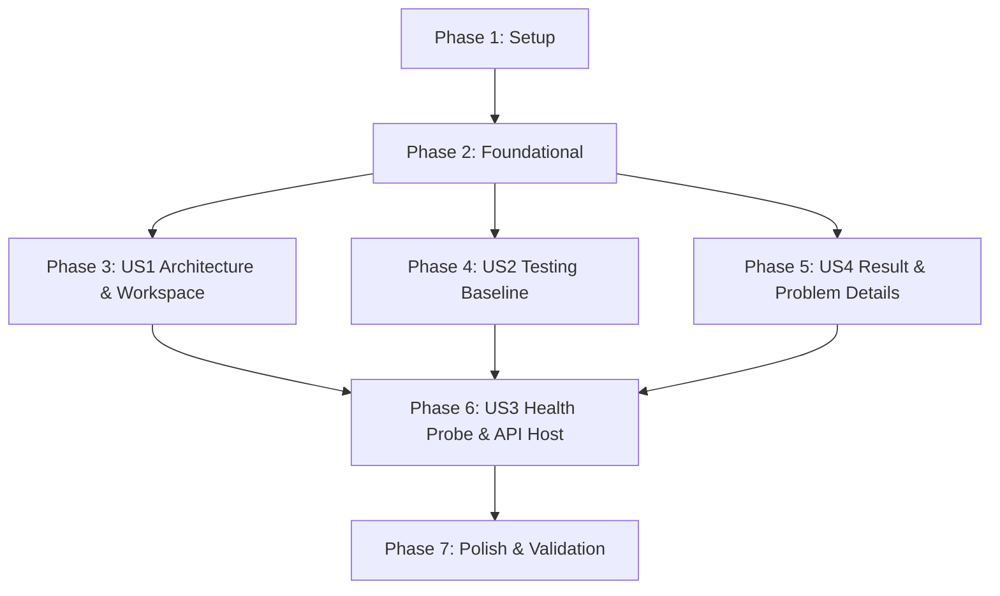

# Tasks: Backend Initialization & Developer Experience (DevEx) Foundation

**Feature**: `001-backend-init-devex` | **Date**: 2026-10-14 | **Spec**: [spec.md](spec.md) | **Plan**: [plan.md](plan.md)

## Phase 1: Setup (Shared Infrastructure)

**Purpose**: Initialize solution, projects, and package references following Clean Architecture and the partitioned root workspace (`src/Backend` and `src/Frontend`).

- [X] T001 Create root folder structure `src/Backend` and `src/Frontend` with placeholder in `src/Frontend/.gitkeep`
- [X] T002 Initialize .NET 10 solution file in `src/Backend/TaskFy.sln`
- [X] T003 [P] Create `TaskFy.Domain` class library project in `src/Backend/TaskFy.Domain/TaskFy.Domain.csproj` and attach to solution
- [X] T004 [P] Create `TaskFy.Application` class library project with `Mapster` and `Mapster.DependencyInjection` in `src/Backend/TaskFy.Application/TaskFy.Application.csproj` and attach to solution
- [X] T005 [P] Create `TaskFy.Infrastructure` class library project with `Microsoft.EntityFrameworkCore.Sqlite` in `src/Backend/TaskFy.Infrastructure/TaskFy.Infrastructure.csproj` and attach to solution
- [X] T006 [P] Create `TaskFy.Api` Web API project with `Swashbuckle.AspNetCore` in `src/Backend/TaskFy.Api/TaskFy.Api.csproj` and attach to solution
- [X] T007 [P] Create `TaskFy.UnitTests` test project with `xunit`, `moq`, and `xunit.runner.visualstudio` in `src/Backend/TaskFy.UnitTests/TaskFy.UnitTests.csproj` and attach to solution
- [X] T008 [P] Create `TaskFy.IntegrationTests` test project with `xunit`, `Microsoft.AspNetCore.Mvc.Testing`, and `Microsoft.Data.Sqlite` in `src/Backend/TaskFy.IntegrationTests/TaskFy.IntegrationTests.csproj` and attach to solution
- [X] T009 Configure Clean Architecture project references in `.csproj` files (`Api` -> `Infrastructure` -> `Application` -> `Domain`; `UnitTests` -> `Application` & `Domain`; `IntegrationTests` -> `Api` & `Infrastructure`)

---

## Phase 2: Foundational (Blocking Prerequisites)

**Purpose**: Core base abstractions, in-house CQRS engine, Result/Error value objects, and database context foundation required before any user story can proceed.

**⚠️ CRITICAL**: No user story work can begin until this phase is complete.

- [X] T010 Implement `ErrorType` enum with values `Failure`, `Validation`, `NotFound`, `Conflict`, and `Unexpected` in `src/Backend/TaskFy.Domain/Common/ErrorType.cs`
- [X] T011 [P] Implement `Error` value object with properties `Code`, `Description`, `Type`, and factory methods in `src/Backend/TaskFy.Domain/Common/Error.cs`
- [X] T012 [P] Implement `Entity` base class with identifier and domain event collection in `src/Backend/TaskFy.Domain/Common/Entity.cs`
- [X] T013 [P] Implement `IDomainEvent` marker interface in `src/Backend/TaskFy.Domain/Common/IDomainEvent.cs`
- [X] T014 [P] Implement `IUnitOfWork` interface with `CommitAsync` and `RollbackAsync` in `src/Backend/TaskFy.Domain/Repositories/IUnitOfWork.cs`
- [X] T015 [P] Implement non-generic `Result` value object with `IsSuccess`, `IsFailure`, and `Error` in `src/Backend/TaskFy.Application/Common/Result.cs`
- [X] T016 [P] Implement generic `Result<T>` value object with `Value` and conversion operators in `src/Backend/TaskFy.Application/Common/ResultOfT.cs`
- [X] T017 [P] Implement in-house CQRS marker interfaces `ICommand` and `ICommandOfT` in `src/Backend/TaskFy.Application/Cqrs/ICommand.cs`
- [X] T018 [P] Implement in-house CQRS handler interfaces `ICommandHandler` and `ICommandHandlerOfT` in `src/Backend/TaskFy.Application/Cqrs/ICommandHandler.cs`
- [X] T019 [P] Implement in-house CQRS query interfaces `IQuery` and `IQueryHandler` in `src/Backend/TaskFy.Application/Cqrs/IQuery.cs`
- [X] T020 Implement `IDispatcher` interface and `Dispatcher` service resolving handlers via `IServiceProvider` in `src/Backend/TaskFy.Application/Cqrs/Dispatcher.cs`
- [X] T021 [P] Implement Application dependency injection registration extension for CQRS handlers and Mapster in `src/Backend/TaskFy.Application/DependencyInjection.cs`
- [X] T022 Implement `TaskFyDbContext` with `IUnitOfWork` implementation and SQLite configuration in `src/Backend/TaskFy.Infrastructure/Persistence/TaskFyDbContext.cs`
- [X] T023 Implement Infrastructure dependency injection registration for SQLite persistence in `src/Backend/TaskFy.Infrastructure/DependencyInjection.cs`

**Checkpoint**: Foundation ready - user story implementation can now begin in parallel.

---

## Phase 3: User Story 1 - Standardized Project Architecture & Workspace Layout (Priority: P1)

**Goal**: Validate and lock in Clean Architecture layer boundaries (inward-only dependencies) and the strict One-Type-Per-File constitutional constraint.

**Independent Test**: Architecture tests execute and verify zero outward dependencies from Domain and confirm 100% of source files contain exactly one type matching the filename.

- [X] T024 [P] [US1] Create architecture unit test verifying Clean Architecture layer references point strictly inward in `src/Backend/TaskFy.UnitTests/Architecture/ArchitectureTests.cs`
- [X] T025 [P] [US1] Create unit test scanning solution source files to verify the One-Type-Per-File constraint in `src/Backend/TaskFy.UnitTests/Architecture/FileIsolationTests.cs`
- [X] T026 [US1] Configure solution-level build enforcement with nullable reference types and code quality settings in `src/Backend/Directory.Build.props`

**Checkpoint**: User Story 1 validated - architectural governance is automated and enforced by unit tests.

---

## Phase 4: User Story 2 - Automated Testing Baseline & Happy-Path Integration Test Harness (Priority: P1)

**Goal**: Deliver a turn-key testing environment supporting xUnit + Moq unit test isolation and a `WebApplicationFactory` integration testing fixture with in-memory SQLite.

**Independent Test**: Running `dotnet test src/Backend/TaskFy.sln` boots the in-memory API and executes both unit and integration test fixtures with 100% success.

### Tests & Harness for User Story 2

- [X] T027 [P] [US2] Implement unit tests for `Result` and `Error` creation, invariant checks, and conversion operators in `src/Backend/TaskFy.UnitTests/Common/ResultTests.cs`
- [X] T028 [P] [US2] Implement unit tests for `Dispatcher` command and query handler resolution and execution using Moq in `src/Backend/TaskFy.UnitTests/Cqrs/DispatcherTests.cs`
- [X] T029 [US2] Implement custom `TaskFyWebApplicationFactory` replacing SQLite connection with an open in-memory SQLite connection fixture in `src/Backend/TaskFy.IntegrationTests/Fixtures/TaskFyWebApplicationFactory.cs`
- [X] T030 [US2] Implement `IntegrationTestBase` providing reusable HTTP client helpers and database reset utilities in `src/Backend/TaskFy.IntegrationTests/Fixtures/IntegrationTestBase.cs`

**Checkpoint**: User Story 2 validated - test fixtures and mocking support are operational and ready for feature vertical slices.

---

## Phase 5: User Story 4 - Resilient Result Pattern & RFC 7807 Problem Details Baseline (Priority: P2)

**Goal**: Standardize error handling and HTTP translation so that business errors produce strongly-typed Result failures, and all API errors (4xx/5xx) are uniformly returned as `application/problem+json` per RFC 7807.

**Independent Test**: Verification that validation errors produce `ValidationProblemDetails` (HTTP 400), not found produces HTTP 404 Problem Details, and unhandled faults produce HTTP 500 Problem Details.

### Implementation for User Story 4

- [X] T031 [P] [US4] Implement unit tests verifying `ToProblemDetails` mapping from `ErrorType` to HTTP status codes in `src/Backend/TaskFy.UnitTests/Middleware/ProblemDetailsMappingTests.cs`
- [X] T032 [P] [US4] Implement `ProblemDetailsResultExtensions` translating `Result` failures to `ProblemDetails` and `ValidationProblemDetails` in `src/Backend/TaskFy.Api/Middleware/ProblemDetailsResultExtensions.cs`
- [X] T033 [US4] Implement `GlobalExceptionHandlingMiddleware` intercepting unhandled exceptions and returning RFC 7807 Problem Details in `src/Backend/TaskFy.Api/Middleware/GlobalExceptionHandlingMiddleware.cs`
- [X] T034 [US4] Implement integration tests verifying RFC 7807 Problem Details response on invalid route (404) and simulated fault (500) conforming to `contracts/problem-details.json` in `src/Backend/TaskFy.IntegrationTests/Middleware/ProblemDetailsIntegrationTests.cs`

**Checkpoint**: User Story 4 validated - all API errors conform to RFC 7807 Problem Details without exception leakage.

---

## Phase 6: User Story 3 - Baseline Diagnostic Health Check & Developer Feedback Loop (Priority: P2)

**Goal**: Provide a runnable API with interactive Swagger documentation, automatic SQLite schema migration on startup in Development, and an active `/health` diagnostic endpoint implemented as an ASP.NET Core Controller.

**Independent Test**: Issue an HTTP GET request to `/health`, receiving HTTP 200 OK in under 200ms matching [contracts/health-api.json](contracts/health-api.json).

### Implementation for User Story 3

- [X] T035 [P] [US3] Create `GetHealthQuery` query record in `src/Backend/TaskFy.Api/Features/Diagnostics/GetHealthQuery.cs`
- [X] T036 [P] [US3] Create `HealthResponseDto` data transfer record with `Status`, `Timestamp`, `Version`, and `Environment` in `src/Backend/TaskFy.Api/Features/Diagnostics/HealthResponseDto.cs`
- [X] T037 [US3] Implement `GetHealthQueryHandler` returning `Result<HealthResponseDto>` in `src/Backend/TaskFy.Api/Features/Diagnostics/GetHealthQueryHandler.cs`
- [X] T038 [US3] Implement `HealthController` inheriting from `ControllerBase` with `[HttpGet("health")]` route in `src/Backend/TaskFy.Api/Features/Diagnostics/HealthController.cs`
- [X] T039 [US3] Configure `Program.cs` registering controllers, Swagger/OpenAPI, Problem Details, and automated SQLite migration on startup in Development (`context.Database.MigrateAsync()`) in `src/Backend/TaskFy.Api/Program.cs`
- [X] T040 [US3] Configure `appsettings.json` and `appsettings.Development.json` with SQLite connection string `Data Source=taskfy.db` in `src/Backend/TaskFy.Api/appsettings.json`
- [X] T041 [US3] Implement mandatory happy-path integration test for `GET /health` verifying HTTP 200 OK and response schema in `src/Backend/TaskFy.IntegrationTests/Features/Diagnostics/HealthEndpointTests.cs`

**Checkpoint**: User Story 3 validated - API boots, migrates DB, documents via Swagger, and passes the happy-path integration test for `/health`.

---

## Phase 7: Polish & Cross-Cutting Concerns

**Purpose**: Execute end-to-end validation, verify documentation, and ensure clean builds.

- [X] T042 [P] Validate complete build and test execution from repository root per [quickstart.md](quickstart.md)
- [X] T043 Code audit verifying One-Type-Per-File compliance across all backend projects with zero compiler warnings

---

## Dependencies & Execution Order

### Phase Dependencies

- **Setup (Phase 1)**: Can start immediately.
- **Foundational (Phase 2)**: Depends on Setup (Phase 1) completion. Blocks all User Stories.
- **US1 (Phase 3) & US2 (Phase 4)**: Can proceed in parallel once Phase 2 is complete.
- **US4 (Phase 5)**: Builds on Result pattern from Phase 2, can run in parallel with US1/US2.
- **US3 (Phase 6)**: Assembles the API host, Controller, Swagger, and Happy-Path integration test. Requires US2 (harness) and US4 (Problem Details).
- **Polish (Phase 7)**: Runs after all User Stories complete.

---

## Parallel Execution Opportunities

### Phase 1: Setup
- `T003`, `T004`, `T005`, `T006`, `T007`, `T008` (all separate `.csproj` project files) can be generated in parallel.

### Phase 2: Foundational
- `T011`, `T012`, `T013`, `T014` (Domain layer value objects and interfaces) can be created in parallel.
- `T015`, `T016`, `T017`, `T018`, `T019` (Application Result and CQRS contracts) can be created in parallel.

### Phase 4: US2 & Phase 5: US4
- `T027` (ResultTests) and `T028` (DispatcherTests) can run in parallel.
- `T031` (ProblemDetailsMappingTests) can run in parallel with unit test creation.

### Phase 6: US3
- `T035` (GetHealthQuery) and `T036` (HealthResponseDto) can be created in parallel.

---

## Implementation Strategy (MVP First)

1. **Phase 1 & Phase 2**: Build the Clean Architecture scaffold and in-house CQRS engine.
2. **Phase 3 (US1) & Phase 4 (US2)**: Establish automated architecture guards and the `WebApplicationFactory` in-memory SQLite testing fixture.
3. **Phase 5 (US4)**: Wire RFC 7807 Problem Details into the API pipeline.
4. **Phase 6 (US3)**: Implement `HealthController`, Swagger, and the mandatory happy-path integration test (**MVP Complete**).
5. **Phase 7**: Run the full validation suite per `quickstart.md`.
