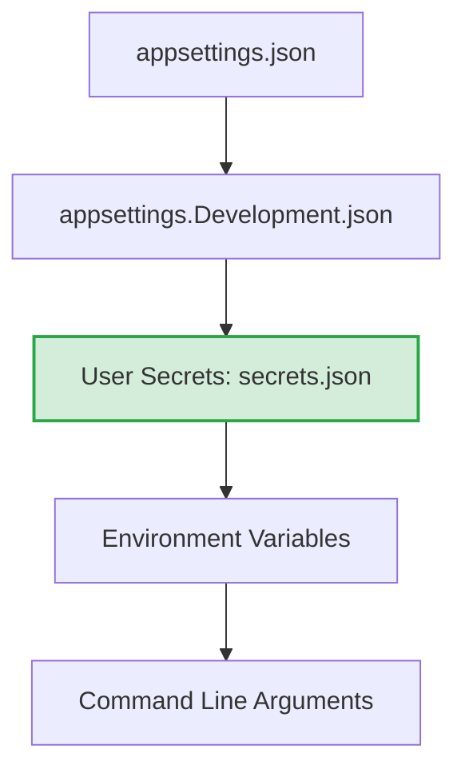

# Configuration & Data Model: Development Security & Cross-Origin Experience

## Overview
This feature introduces no persistent relational database tables or EF Core entities. All models are in-memory configuration structures, descriptors, and runtime policy definitions governing .NET User Secrets and ASP.NET Core CORS middleware.

---

## Configuration Models & Descriptors

### 1. `DevelopmentCorsOptions` (Logical Descriptor)
Encapsulates runtime settings for Cross-Origin Resource Sharing during local developer iteration.

| Field | Type | Required | Description | Example / Default |
| :--- | :--- | :--- | :--- | :--- |
| `PolicyName` | `string` | Yes | Identifier for the development CORS policy | `"DevelopmentCorsPolicy"` |
| `AllowAnyOrigin` | `bool` | Yes | Whether requests from any origin are permitted | `true` |
| `AllowAnyMethod` | `bool` | Yes | Whether any HTTP method (`GET`, `POST`, `OPTIONS`, etc.) is permitted | `true` |
| `AllowAnyHeader` | `bool` | Yes | Whether custom request headers are accepted | `true` |
| `AllowCredentials` | `bool` | Yes | Whether credentials (cookies/auth headers) with wildcard origin are allowed | `false` *(must be false with wildcard origin)* |

---

### 2. `UserSecretsDescriptor` (Project Context)
Represents the local user secrets configuration provider association.

| Field | Type | Required | Description | Example / Location |
| :--- | :--- | :--- | :--- | :--- |
| `UserSecretsId` | `string` | Yes | Unique GUID identifying the secrets store on developer's machine | XML property in `TaskFy.Api.csproj` |
| `StoragePath` | `string` | System-managed | Machine-isolated directory path outside repository | `%APPDATA%\Microsoft\UserSecrets\<Id>\secrets.json` |
| `PrecedenceOrder` | `int` | High | Priority in .NET Configuration builder pipeline | Overrides `appsettings.json` and `appsettings.Development.json` |

---

## Configuration Hierarchy & Precedence

1. **`appsettings.json`**: Base, non-sensitive application defaults.
2. **`appsettings.Development.json`**: Development-specific flags (e.g. SQLite connection string `Data Source=taskfy.db`).
3. **`User Secrets` (Top precedence in local development)**: Machine-isolated developer credentials, private tokens, or connection overrides.
