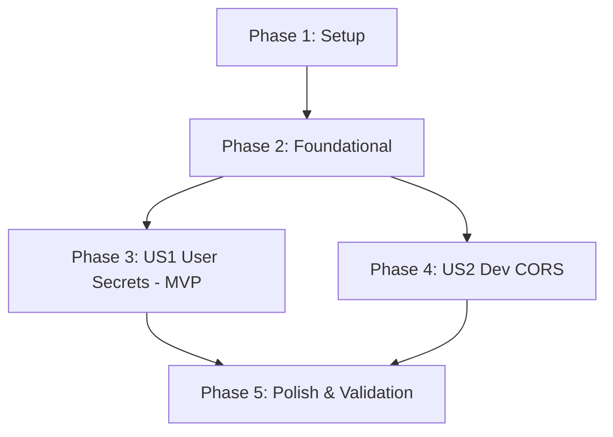

# Tasks: Development Security & Cross-Origin Experience (User Secrets & Dev CORS)

**Feature**: Development Security & Cross-Origin Experience (User Secrets & Dev CORS)  
**Spec**: [spec.md](spec.md) | **Plan**: [plan.md](plan.md)  
**Status**: Ready for Implementation  

---

## Phase 1: Setup (Shared Infrastructure)

**Purpose**: Project configuration and baseline repository hygiene.

- [X] T001 Provision unique `<UserSecretsId>` element in `src/Backend/TaskFy.Api/TaskFy.Api.csproj`
- [X] T002 [P] Audit configuration files to verify zero sensitive credentials in `src/Backend/TaskFy.Api/appsettings.json` and `src/Backend/TaskFy.Api/appsettings.Development.json`

---

## Phase 2: Foundational (Blocking Prerequisites)

**Purpose**: Establish modular extension architecture ensuring CORS configuration is not embedded directly in `Program.cs`.

- [X] T003 Create skeleton `CorsExtensions` class with `DevelopmentCorsPolicy` constant in `src/Backend/TaskFy.Api/Extensions/CorsExtensions.cs`

**Checkpoint**: Foundation ready - User Story implementation can proceed.

---

## Phase 3: User Story 1 - Secure Local Configuration Isolation via User Secrets (Priority: P1) 🎯 MVP

**Goal**: Enable machine-isolated local developer secrets outside the repository while guaranteeing base configuration files remain credential-free.

**Independent Test**: Verify that the API assembly exposes a valid `UserSecretsIdAttribute`, and storing a key via `dotnet user-secrets set` allows reading configuration without modifying tracked repository files.

### Tests for User Story 1

- [X] T004 [US1] Create unit test verifying `UserSecretsIdAttribute` metadata in `src/Backend/TaskFy.UnitTests/Configuration/UserSecretsConfigurationTests.cs`

### Implementation for User Story 1

- [X] T005 [US1] Validate developer secret persistence outside repository using `dotnet user-secrets` CLI in `src/Backend/TaskFy.Api/TaskFy.Api.csproj`

**Checkpoint**: User Story 1 validated - local developer secrets are safely isolated outside source control.

---

## Phase 4: User Story 2 - Generic Cross-Origin Access for Local Frontend Development (Priority: P2)

**Goal**: Allow local frontend clients (such as Angular on `http://localhost:4200` or local tools) to interact with the API across origins without CORS or preflight rejections.

**Independent Test**: Issue an `OPTIONS` preflight request and a `GET /health` request with header `Origin: http://localhost:4200` to the API in development mode, verifying HTTP 200/204 response and `Access-Control-Allow-Origin: *` conforming to [contracts/cors-api.json](contracts/cors-api.json).

### Tests for User Story 2

- [X] T006 [P] [US2] Create unit tests for CORS service registration in `src/Backend/TaskFy.UnitTests/Extensions/CorsExtensionsTests.cs`
- [X] T007 [P] [US2] Create integration test for cross-origin preflight `OPTIONS` and actual `GET` requests in `src/Backend/TaskFy.IntegrationTests/Features/Cors/CorsEndpointTests.cs`

### Implementation for User Story 2

- [X] T008 [US2] Implement `AddDevelopmentCors` and `UseDevelopmentCors` methods with `AllowAnyOrigin`, `AllowAnyMethod`, and `AllowAnyHeader` in `src/Backend/TaskFy.Api/Extensions/CorsExtensions.cs`
- [X] T009 [US2] Wire `AddDevelopmentCors` and `UseDevelopmentCors` into the development pipeline in `src/Backend/TaskFy.Api/Program.cs`

**Checkpoint**: User Story 2 validated - frontend cross-origin requests and preflight options succeed seamlessly.

---

## Phase 5: Polish & Cross-Cutting Concerns

**Purpose**: Execute end-to-end validation, verify build cleanliness, and enforce architectural rules.

- [X] T010 [P] Validate complete test suite execution with `dotnet test` in `src/Backend/TaskFy.sln`
- [X] T011 Code audit verifying One-Type-Per-File compliance and absence of inline CORS configuration in `src/Backend/TaskFy.Api/Program.cs`

---

## Dependencies & Execution Order

### Phase Dependencies

- **Setup (Phase 1)**: Can start immediately.
- **Foundational (Phase 2)**: Depends on Setup completion. Blocks User Stories.
- **User Story 1 (Phase 3)**: Depends on Phase 2. Can be implemented and verified independently.
- **User Story 2 (Phase 4)**: Depends on Phase 2. Can proceed in parallel with US1.
- **Polish (Phase 5)**: Runs after all user story implementations are complete.

---

## Parallel Execution Opportunities

- `T002` (Config audit) can run in parallel with `T001` (UserSecretsId provisioning).
- `T006` (Unit tests for CORS) and `T007` (Integration tests for CORS) can be implemented in parallel.
- `T010` (Full suite test run) and `T011` (Code audit) can run in parallel during Phase 5.

---

## Implementation Strategy

### MVP Scope (User Story 1)
- Complete Phase 1 and Phase 2.
- Execute Phase 3 (User Story 1): User Secrets metadata and CLI persistence.
- Validates the core security requirement before enabling network-level cross-origin access.

### Incremental Delivery (User Story 2)
- Execute Phase 4 (User Story 2): Add `CorsExtensions.cs`, wire into `Program.cs`, and validate via integration tests against `/health`.
- Conclude with Phase 5 verification.
