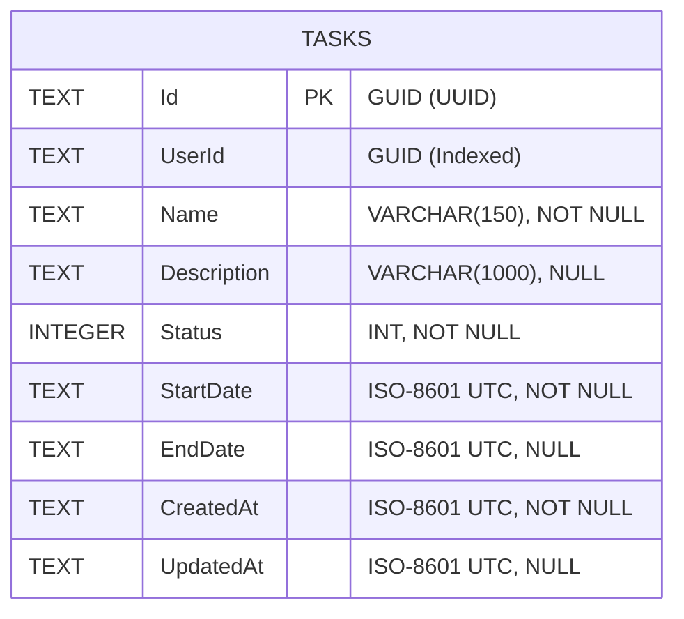

# Data Model: Task Creation & Query Management (003-task-management)

## Entities & Aggregate Roots

### 1. `TaskItem` (Aggregate Root)
Encapsulates all domain logic, invariants, and lifecycle transitions for a personal task.

| Field | Type | Nullable | Validation / Invariants | Description |
| :--- | :--- | :---: | :--- | :--- |
| `Id` | `Guid` | No | System-generated UUID | Unique aggregate identifier |
| `UserId` | `Guid` | No | Non-empty Guid | Owner identifier (test user in Phase 1) |
| `Name` | `string` | No | Length: 3 to 150 characters, trimmed, non-empty | Title/name of the task |
| `Description` | `string?` | Yes | Max length: 1000 characters | Detailed explanation |
| `Status` | `TaskStatus` | No | Enum value (defaults to `Pending`) | Current lifecycle status |
| `StartDate` | `DateTimeOffset` | No | UTC timestamp | Planned or actual start date |
| `EndDate` | `DateTimeOffset?` | Yes | Must be `>= StartDate` when provided | Completion or due date |
| `CreatedAt` | `DateTimeOffset` | No | UTC timestamp set on creation | Creation audit timestamp |
| `UpdatedAt` | `DateTimeOffset?` | Yes | UTC timestamp set on mutation | Last modification audit timestamp |

---

### 2. `TaskStatus` (Domain Enum)
Defines the distinct lifecycle states of a task.

```csharp
namespace TaskFy.Domain.Enums;

public enum TaskStatus
{
    Pending = 1,
    InProgress = 2,
    Completed = 3,
    Cancelled = 4
}
```

---

## Database Relational Mapping (SQLite Table: `Tasks`)



### Table Indexes:
- `PK_Tasks`: Clustered on `Id`.
- `IX_Tasks_UserId`: Non-clustered on `UserId` for efficient multi-user partition filtering.
- `IX_Tasks_UserId_Status`: Composite index for status-filtered queries.
- `IX_Tasks_UserId_CreatedAt`: Composite index for creation date range ordering.

---

## Application DTOs & Query Filters

### `TaskDto` (Presentation Record)
```csharp
public sealed record TaskDto(
    Guid Id,
    Guid UserId,
    string Name,
    string? Description,
    string Status,
    DateTimeOffset StartDate,
    DateTimeOffset? EndDate,
    DateTimeOffset CreatedAt,
    DateTimeOffset? UpdatedAt);
```

### `TaskFilterCriteria` (Query Parameters)
- `SearchTerm` (`string?`): Search term matched against `Name` and `Description`.
- `Status` (`TaskStatus?`): Optional status filter.
- `CreatedFrom` (`DateTimeOffset?`): Start of creation date range.
- `CreatedTo` (`DateTimeOffset?`): End of creation date range.
- `DueFrom` (`DateTimeOffset?`): Start of end date range.
- `DueTo` (`DateTimeOffset?`): End of end date range.
