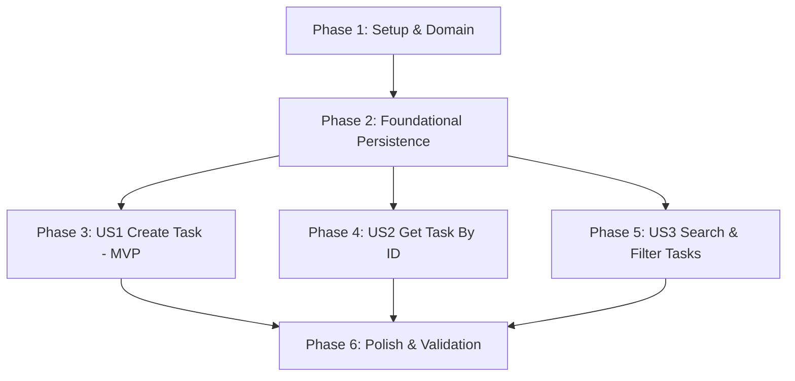

# Tasks: Task Creation & Query Management (003-task-management)

**Feature**: Task Creation & Query Management (Cadastro e Consulta de Tarefas)  
**Spec**: [spec.md](spec.md) | **Plan**: [plan.md](plan.md)  
**Status**: Ready for Implementation  

---

## Phase 1: Setup & Domain Infrastructure

**Purpose**: Core domain types, enumerations, error definitions, and repository abstractions for tasks.

- [X] T001 [P] Create `TaskStatus` enum (`Pending = 1, InProgress = 2, Completed = 3, Cancelled = 4`) in `src/Backend/TaskFy.Domain/Enums/TaskStatus.cs`
- [X] T002 [P] Create `TaskErrors` strongly-typed errors class with `NotFound`, `InvalidDates`, and `InvalidName` in `src/Backend/TaskFy.Domain/Errors/TaskErrors.cs`
- [X] T003 [P] Create `TaskCreatedDomainEvent` record implementing `IDomainEvent` in `src/Backend/TaskFy.Domain/Events/TaskCreatedDomainEvent.cs`
- [X] T004 Create `TaskItem` aggregate root entity inheriting from `Entity` with `Create(...)` factory method in `src/Backend/TaskFy.Domain/Entities/TaskItem.cs`
- [X] T005 [P] Create `ITaskRepository` interface declaring `GetByIdAsync`, `SearchAsync`, `AddAsync`, `Update`, and `Delete` in `src/Backend/TaskFy.Domain/Repositories/ITaskRepository.cs`

---

## Phase 2: Foundational (Application Interfaces, EF Core Persistence & Migrations)

**Purpose**: Shared infrastructure and persistence configurations that MUST be complete before user stories can be integrated.

- [X] T006 [P] Create `IUserContext` interface declaring `Guid CurrentUserId { get; }` in `src/Backend/TaskFy.Application/Common/Interfaces/IUserContext.cs`
- [X] T007 [P] Create `DefaultUserContext` in `src/Backend/TaskFy.Api/Common/DefaultUserContext.cs` returning test user GUID `00000000-0000-0000-0000-000000000001`
- [X] T008 [P] Create `TaskDto` presentation record in `src/Backend/TaskFy.Application/Features/Tasks/DTOs/TaskDto.cs`
- [X] T009 Create `TaskItemConfiguration` implementing `IEntityTypeConfiguration<TaskItem>` mapping table `"Tasks"`, columns, and indexes in `src/Backend/TaskFy.Infrastructure/Persistence/Configurations/TaskItemConfiguration.cs`
- [X] T010 Update `TaskFyDbContext` adding `DbSet<TaskItem> Tasks` and registering `TaskItemConfiguration` in `src/Backend/TaskFy.Infrastructure/Persistence/TaskFyDbContext.cs`
- [X] T011 Implement `TaskRepository` adhering to `ITaskRepository` with non-tracking (`AsNoTracking()`) reads in `src/Backend/TaskFy.Infrastructure/Persistence/Repositories/TaskRepository.cs`
- [X] T012 Register `ITaskRepository` in `src/Backend/TaskFy.Infrastructure/DependencyInjection.cs` and `IUserContext` in `src/Backend/TaskFy.Api/Program.cs`
- [X] T013 Create EF Core SQLite migration `AddTasksSchema` in `src/Backend/TaskFy.Infrastructure/Persistence/Migrations/`

**Checkpoint**: Foundational layer complete - user stories can now proceed.

---

## Phase 3: User Story 1 - Cadastrar Nova Tarefa (Priority: P1) 🎯 MVP

**Goal**: Allow creating a task with name, description, start date, and optional end date under the active user context.

**Independent Test**: Issue `POST /tasks` with valid payload and receive HTTP 201 Created with Location header and persisted task data; invalid payloads return RFC 7807 Problem Details.

### Tests for User Story 1

- [X] T014 [P] [US1] Create unit tests for `TaskItem.Create` validating title constraints and date invariants in `src/Backend/TaskFy.UnitTests/Domain/TaskItemTests.cs`
- [X] T015 [P] [US1] Create unit tests for `CreateTaskCommandHandler` using Moq for repository and UnitOfWork in `src/Backend/TaskFy.UnitTests/Features/Tasks/CreateTaskCommandHandlerTests.cs`
- [X] T016 [P] [US1] Create mandatory happy-path and validation integration test for `POST /tasks` in `src/Backend/TaskFy.IntegrationTests/Features/Tasks/CreateTaskEndpointTests.cs`

### Implementation for User Story 1

- [X] T017 [P] [US1] Create `CreateTaskCommand` record implementing `ICommand<Result<TaskDto>>` in `src/Backend/TaskFy.Application/Features/Tasks/Commands/CreateTask/CreateTaskCommand.cs`
- [X] T018 [US1] Implement `CreateTaskCommandHandler` in `src/Backend/TaskFy.Application/Features/Tasks/Commands/CreateTask/CreateTaskCommandHandler.cs`
- [X] T019 [P] [US1] Create `CreateTaskRequest` DTO in `src/Backend/TaskFy.Api/Features/Tasks/CreateTaskRequest.cs`
- [X] T020 [US1] Create `TasksController` inheriting from `ControllerBase` with `[HttpPost]` endpoint in `src/Backend/TaskFy.Api/Features/Tasks/TasksController.cs`

**Checkpoint**: User Story 1 validated - tasks can be created and persisted independently.

---

## Phase 4: User Story 2 - Consultar Detalhes da Tarefa por ID (Priority: P2)

**Goal**: Allow retrieving full details of a specific task by its unique ID.

**Independent Test**: Issue `GET /tasks/{id}` for an existing task receiving HTTP 200 OK with `TaskDto`; non-existent ID returns HTTP 404 Problem Details.

### Tests for User Story 2

- [X] T021 [P] [US2] Create unit tests for `GetTaskByIdQueryHandler` in `src/Backend/TaskFy.UnitTests/Features/Tasks/GetTaskByIdQueryHandlerTests.cs`
- [X] T022 [P] [US2] Create mandatory happy-path and 404 integration test for `GET /tasks/{id}` in `src/Backend/TaskFy.IntegrationTests/Features/Tasks/GetTaskByIdEndpointTests.cs`

### Implementation for User Story 2

- [X] T023 [P] [US2] Create `GetTaskByIdQuery` record implementing `IQuery<Result<TaskDto>>` in `src/Backend/TaskFy.Application/Features/Tasks/Queries/GetTaskById/GetTaskByIdQuery.cs`
- [X] T024 [US2] Implement `GetTaskByIdQueryHandler` in `src/Backend/TaskFy.Application/Features/Tasks/Queries/GetTaskById/GetTaskByIdQueryHandler.cs`
- [X] T025 [US2] Add `[HttpGet("{id:guid}")]` endpoint to `TasksController` in `src/Backend/TaskFy.Api/Features/Tasks/TasksController.cs`

**Checkpoint**: User Story 2 validated - individual tasks can be queried by ID independently.

---

## Phase 5: User Story 3 - Listar e Filtrar Tarefas com Busca e Intervalos de Datas (Priority: P3)

**Goal**: Allow searching and filtering tasks by text, status, and creation/due date intervals.

**Independent Test**: Issue `GET /tasks` with query parameters (`searchTerm`, `status`, `createdFrom`, `createdTo`, `dueFrom`, `dueTo`) receiving HTTP 200 OK and filtered list conforming to [contracts/tasks-api.json](contracts/tasks-api.json).

### Tests for User Story 3

- [ ] T026 [P] [US3] Create unit tests for `GetTasksQueryHandler` in `src/Backend/TaskFy.UnitTests/Features/Tasks/GetTasksQueryHandlerTests.cs`
- [ ] T027 [P] [US3] Create mandatory happy-path integration tests for `GET /tasks` with filtering in `src/Backend/TaskFy.IntegrationTests/Features/Tasks/GetTasksEndpointTests.cs`

### Implementation for User Story 3

- [ ] T028 [P] [US3] Create `GetTasksQuery` record implementing `IQuery<Result<IReadOnlyList<TaskDto>>>` in `src/Backend/TaskFy.Application/Features/Tasks/Queries/GetTasks/GetTasksQuery.cs`
- [ ] T029 [US3] Implement `GetTasksQueryHandler` in `src/Backend/TaskFy.Application/Features/Tasks/Queries/GetTasks/GetTasksQueryHandler.cs`
- [ ] T030 [P] [US3] Create `GetTasksRequest` query model in `src/Backend/TaskFy.Api/Features/Tasks/GetTasksRequest.cs`
- [ ] T031 [US3] Add `[HttpGet]` endpoint to `TasksController` in `src/Backend/TaskFy.Api/Features/Tasks/TasksController.cs`

**Checkpoint**: User Story 3 validated - multi-criteria task search and date filtering fully functional.

---

## Phase 6: Polish & Cross-Cutting Concerns

**Purpose**: Execute end-to-end validation, verify build cleanliness, and enforce architectural rules.

- [ ] T032 [P] Validate complete test suite execution with `dotnet test src/Backend/TaskFy.sln` ensuring 100% pass with zero warnings
- [ ] T033 Code audit verifying One-Type-Per-File compliance across all new files and absence of unauthorized external dependencies

---

## Dependencies & Execution Order

### Phase Dependencies

- **Setup & Domain (Phase 1)**: Defines core entities, enums, and repository interfaces.
- **Foundational (Phase 2)**: Establishes DbContext mappings, migrations, and user context. Blocks user stories.
- **User Story 1 (Phase 3 - MVP)**: Can be implemented and verified independently as MVP.
- **User Story 2 (Phase 4)**: Can proceed after Foundational (Phase 2).
- **User Story 3 (Phase 5)**: Can proceed after Foundational (Phase 2).
- **Polish (Phase 6)**: Runs after all user stories complete.

---

## Parallel Execution Opportunities

- In Phase 1: `T001` (enum), `T002` (errors), `T003` (event), and `T005` (repo interface) can run in parallel.
- In Phase 2: `T006` (IUserContext), `T007` (DefaultUserContext), and `T008` (TaskDto) can run in parallel.
- In Phase 3: Unit tests `T014`, `T015`, and integration test `T016` can run in parallel before implementation.
- User Stories 2 and 3 can be developed in parallel once Phase 2 is complete.

---

## Implementation Strategy

### MVP Scope (User Story 1 Only)
1. Complete Phase 1: Domain types (`TaskItem`, `TaskStatus`, `ITaskRepository`).
2. Complete Phase 2: Foundational persistence (`TaskItemConfiguration`, `TaskRepository`, migration).
3. Complete Phase 3: User Story 1 (`CreateTaskCommand`, handler, controller, tests).
4. Validate MVP with `POST /tasks`.

### Incremental Delivery
1. Add User Story 2 (`GetTaskByIdQuery`, endpoint, tests).
2. Add User Story 3 (`GetTasksQuery`, search/filter query, endpoint, tests).
3. Validate full suite in Phase 6.
